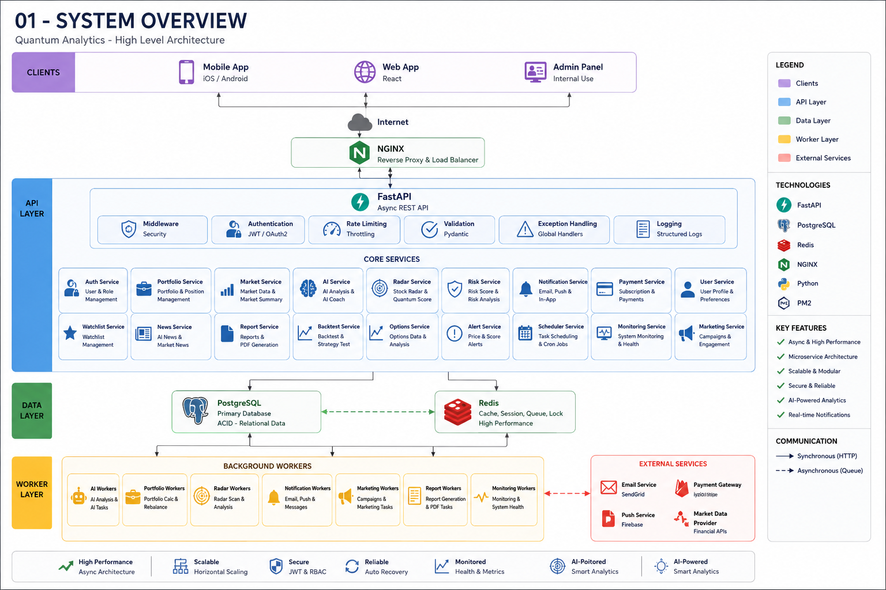
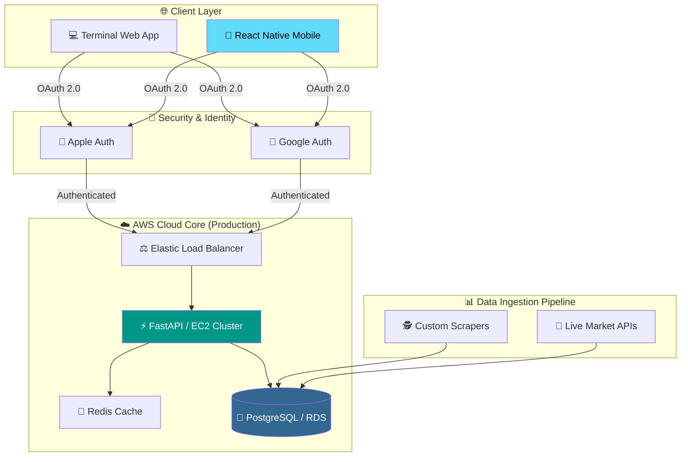

<<<<<<< HEAD
# quantum-analiz

### A high-performance analytical engine and system architecture showcase for financial intelligence.

[](https://www.python.org/)
[](./LICENSE)
[](#testing-strategy)

---

## Engineering Showcase Notice

This repository serves exclusively as a **public engineering showcase** to demonstrate system architecture, algorithmic design, data processing pipelines, and software engineering practices.

It is **not** a production system, **not** an open-source SaaS backend, **not** a trading bot, and **not** a financial advisory tool.

Proprietary components, including production API keys, live database schemas, commercial deployment pipelines, proprietary AI prompting strategy matrices, and low-latency execution loops, have been intentionally excluded or replaced with mocks in this public version.

---

## System Overview

Modern financial analysis requires bridging the gap between high-velocity technical indicators, unstructured community sentiment, and macroeconomic indices. This engine solves the problem of consolidating heterogeneous data streams into structured, deterministic, and context-aware intelligence. It provides a modular approach to quantitative calculation, natural language insight generation, and macroeconomic correlation analysis.

---

## Architecture Overview

The system is designed with a decoupled, modular architecture to scale components independently. A full architectural breakdown and asset layout can be seen in the following system diagram:



The architectural blueprint consists of four primary layers:
*   **API Layer**: Handles routing, request validation, rate limiting, and client telemetry.
*   **AI Layer**: Manages retrieval-augmented generation pipelines, prompt engineering schemas, and language model inference.
*   **Worker Layer**: Executes background cron tasks, parallel processing, and analytical computations.
*   **Data Layer**: Houses structured relational schemas, fast cache invalidation stores, and daily transaction tables.

---

## Engineering Highlights

*   **AI-Powered Financial Analytics Engine**: Converts quantitative indicators and macro correlations into actionable insights via natural language commentary.
*   **Grounding-Based AI Architecture**: Implements strict factual grounding rules, preventing model hallucinations by tying text generation strictly to computed indicators.
*   **Modular Algorithmic Design**: Decouples mathematical scoring logic from database models, permitting isolated test cycles and updates.
*   **Event-Driven Worker Architecture**: Prepares background queues for asynchronous market updates and processing spikes.
*   **High-Performance Data Processing**: Leverages vectorized operations in NumPy and Pandas to minimize compute latency during cross-signal synthesis.
*   **Production-Grade API Design**: Adheres to clean routing principles, type safety, and REST conventions.

---

## Core Analytical Engines

### Quantum Signal Cross Engine
The `QuantumEngine` synthesizes technical indicators and community sentiment data to calculate a unified **Quantum Score (0–100)**.
*   **Technical Score (Max 100)**: Consists of an **RSI Dip Recovery** evaluation (RSI drop below 35 followed by a recovery above 45 within a 5-day window) and a **Volume Spike** evaluation (today's volume against 20-day simple moving average).
*   **Sentiment Score (Max 100)**: Maps social media stance distribution. Employs a confidence multiplier to penalize low sample sizes to mitigate manipulative noise.
*   **Dynamic Weighting**: Dynamically adjusts technical and sentiment weights depending on message activity to prioritize high-confidence data.

### Macro Correlation Engine
The `MacroCorrelationEngine` computes Pearson correlation coefficients ($\rho$) between daily return series of target assets and macroeconomic benchmarks (BIST100, USD/TRY, Gold).
*   Provides statistical context on whether an asset aligns with market-wide momentum or exhibits defensive hedge properties.
*   Normalizes covariance to produce structured financial commentary mapping index relationships.

### Advanced Technical Commentary Engine
The `AdvancedTechnicalEngine` maps raw quantitative values (RSI, Bollinger Bands, MACD) to deterministic, highly structured natural language narratives.
*   Eliminates numerical ambiguity by translating indicators into context-appropriate risk brackets and actionable commentary.

---

## Engineering Principles

*   **Clean Architecture**: Enforces boundary separation between domain logic, data persistence, and interface endpoints.
*   **Modularity**: Every engine exists as a standalone module to ensure code readability and single-responsibility principles.
*   **Test-Driven Design**: Ensures 100% test coverage on mathematical scoring engines to guarantee precision.
*   **Performance-First Design**: Optimized data structures and vectorized operations over iterative loops to lower CPU footprints.
*   **Type Safety**: Enforced type hints (`typing` module) across the codebase for structural safety and IDE diagnostics.

---

## Repository Structure

```text
quantumanaliz/
├── LICENSE                 # Public Showcase License (QASL v1.0)
├── README.md               # Showcase engineering report
├── requirements.txt        # Showcase dependencies
├── showcase_app.py         # Simulation entry point
├── assets/                 # Architecture diagrams
│   ├── 01-system-overview.png.png
│   ├── 03-ai-pipeline.png.png
│   └── 06-database-er.png.png
├── core/                   # Analytical engine core modules
│   ├── __init__.py
│   ├── engine.py           # Signal Cross Logic
│   ├── correlation.py      # Macro Correlation Logic
│   └── indicators.py       # Technical Commentary Logic
└── tests/                  # Validation suites
    ├── __init__.py
    └── test_showcase.py    # Algorithmic test suite
=======

---

# 🌌 QUANTUM ANALİZ — Enterprise Financial Intelligence & Ecosystem

---

## 🏗️ ENTERPRISE SYSTEM ARCHITECTURE

Platformun mimarisi, verinin Bursa'dan (yerel kaynaklar) başlayıp AWS global sunucularına uzanan yolculuğunu ve kullanıcıya ulaşan son katmanı kapsar:



---

## 🚀 TECHNOLOGICAL DEEP DIVE

### 🐘 1. ANALYTICAL DATABASE LAYER (POSTGRESQL)

Proje, finansal verilerin karmaşıklığını yönetmek için **Amazon RDS (PostgreSQL)** üzerine kurgulanmıştır.

* **Time-Series Data:** Hisse senedi fiyat hareketleri, yüksek hacimli zaman serisi verileri olarak PostgreSQL üzerinde optimize edilmiş indekslerle saklanır.
* **Relational Integrity:** Kullanıcı portföyleri, takip listeleri ve finansal rasyolar arasındaki ilişkiler, **3. Normal Form (3NF)** prensiplerine sadık kalarak modellendi.
* **Performance:** Karmaşık finansal sorgular için `Stored Procedures` ve `Views` katmanları kullanılarak API üzerindeki yük minimize edildi.

### 🔐 2. IDENTITY MANAGEMENT (SSO INTEGRATION)

Kurumsal güvenlik standartlarını karşılamak için **Single Sign-On (SSO)** yapısı entegre edildi:

* **Apple Auth:** iOS kullanıcıları için biyometrik güvenlikle entegre, sıfır-bilgi (zero-knowledge) gizlilik odaklı giriş katmanı.
* **Google Auth:** Geniş kullanıcı kitlesi için standartlaştırılmış, güvenli OAuth 2.0 kimlik doğrulama akışı.
* **JWT Security:** Başarılı giriş sonrası sistem, tüm API isteklerini doğrulamak için şifrelenmiş **JSON Web Token** (JWT) üretir.

### ☁️ 3. AWS "FULL-STACK" INFRASTRUCTURE

Sistem, AWS üzerinde tamamen izole edilmiş bir **VPC (Virtual Private Cloud)** içerisinde yaşar:

* **High Availability:** Sunucular farklı `Availability Zone`'larda yedekli çalışır.
* **S3 Data Lake:** Ham borsa dataları ve loglar, ileriye dönük model eğitimi için S3 üzerinde arşivlenir.
* **CloudWatch:** Sistemin sağlığı, API gecikmeleri ve veritabanı sorgu süreleri 7/24 izlenir.

### 📱 4. MULTI-PLATFORM FRONTEND (WEB & MOBILE)

* **React Native:** Tek kod tabanıyla hem iOS hem Android üzerinde çalışan, finansal grafiklerin 60 FPS akıcılıkla render edildiği mobil uygulama.
* **Web Terminal:** Profesyonel yatırımcılar için geliştirilmiş, büyük ekranlarda detaylı teknik analiz yapılmasına olanak sağlayan web arayüzü.

---

## 📂 REPOSITORY & DEPLOYMENT LOGIC

Bu repo, sistemin **Showcase** (vitrin) sürümüdür. Algoritmik sırlar ve ticari mantık özel repolarda saklanır:

```text
.
├── aws-infra/          # CloudFormation / Terraform (Infrastructure as Code)
├── backend-fastapi/    # RESTful API logic & PostgreSQL migrations
├── mobile-app/         # React Native (iOS & Android) source
├── web-dashboard/      # Terminal web interface
├── security/           # OAuth2, Apple & Google Auth handlers
└── README.md           # Engineering blueprint

>>>>>>> 1a06bd4a1cce55b498d8cb36f8d73d16022d5260
```

---

<<<<<<< HEAD
## Documentation

A full documentation repository resides in the `/docs` directory (in the production repository layout) structured as follows:
*   `AI/`: Model integration schemas, grounding prompt patterns, and context window optimization.
*   `API/`: Route specifications, request/response models, and status code guidelines.
*   `Architecture/`: High-level system design documents and component topologies.
*   `Workers/`: Queue design, message broker topologies, and retry policies.
*   `ADR/`: Architectural Decision Records for historical engineering alignment.
*   `Deployment/`: Infrastructure-as-Code setups and environment configurations.
*   `Diagrams/`: Vector export files of system visual assets.

---

## Architecture Decisions (ADR)

### FastAPI
*   **Decision**: Selected as the primary API framework.
*   **Rationale**: Provides high throughput due to asynchronous loop support (`uvloop`), auto-generates OpenAPI documentation, and enforces static typing checks via Pydantic.

### PostgreSQL
*   **Decision**: Relational engine for analytical profiles.
*   **Rationale**: Enforces ACID compliance, handles relational indexes efficiently, and scales for complex portfolio queries.

### Redis
*   **Decision**: Caching layer.
*   **Rationale**: Used for hot-path indicator data and rate-limiting storage to prevent API exhaustion.

### Worker Architecture
*   **Decision**: Decoupled background task runners.
*   **Rationale**: Keeps the web API layer lightweight and prevents latency spikes during heavy numerical calculations by processing tasks asynchronously.

### Grounding AI
*   **Decision**: Deterministic grounding layer for language model outputs.
*   **Rationale**: Replaces open-ended chat queries with rigid schema validation to prevent model hallucinations in financial context.

---

## Running the Showcase

### Prerequisites
*   Python 3.10, 3.11, or 3.12
*   virtualenv

### Setup
```bash
# Initialize virtual environment
python3 -m venv venv
source venv/bin/activate

# Install dependencies
pip install -r requirements.txt

# Execute simulation
python showcase_app.py
```

---

## Testing Strategy

All core algorithms are verified through automated unit tests. Calculations including RSI dip recovery, volume ratio mapping, sentiment normalization, and Pearson correlation coefficients are tested to ensure mathematical precision.

Run the test suite:
```bash
pytest tests/
```

---

## Roadmap

*   **AI Expansion**: Incorporating retrieval pipelines for PDF financial reports and SEC filings.
*   **Portfolio Intelligence**: Building optimization models for risk-adjusted asset allocation.
*   **Real-Time Analytics**: Transitioning calculations to stream-processing pipelines.

---

## Repository Philosophy

This project demonstrates software engineering quality over a complete product feature set. It shows how numerical data flows through a clean backend system, translates into text via a grounded pipeline, and calculates correlations against macro benchmarks.

---

## License

This repository is licensed under the **Quantum Analytics Source Available License (QASL v1.0)**. Refer to the [LICENSE](./LICENSE) file for usage boundaries and source restrictions.

---

## Developer Section

**Ferhat Koç**  
*Data Engineer & Quant Developer*  
*   **GitHub**: [ferhattkoc-ml](https://github.com/ferhattkoc)  
*   **Website**: [quantumanaliz.com](https://www.quantumanaliz.com)  

---
*Disclaimer: This repository is intended for engineering demonstration purposes only. It is not financial advice.*
=======
## 👨‍💻 DEVELOPER & SYSTEM ARCHITECT

**Ferhat Koç**

*Data Engineer & Quant Developer*

GitHub: [ferhattkoc-ml]()

Web: https://www.quantumanaliz.com

---

>>>>>>> 1a06bd4a1cce55b498d8cb36f8d73d16022d5260
